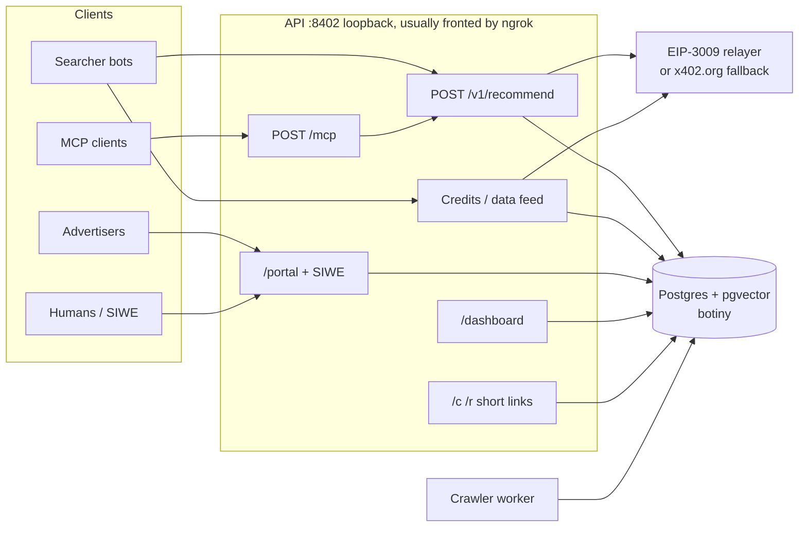

# Botiny

<p align="center">
  
  
</p>

<p align="center"><strong>A testnet x402 bot service-discovery marketplace.</strong><br>
Bots pay to discover services. Advertisers pay to be promoted. Every paid search is logged and can be replayed byte-for-byte.</p>

**Testnet only.** Mainnets are listed in code but hard-disabled. No real funds.

Status date: **23 November 2026, Europe/London**. Canonical repo: [github.com/blackboxmerkle-core/botiny](https://github.com/blackboxmerkle-core/botiny), branch `main`.

## Current status

Feature work is **paused** until the profitability models are signed off (pause in effect since 14 October 2026). The last code shipped before the pause is on `main`: prepaid search credits, the promo-v4 ranker, the MCP server at `POST /mcp`, and data-feed subscriptions, on top of tracked links, the human portal, the click server, and four security rounds.

**Health check, 23 November 2026, 11:53 Europe/London**

| Check | Result |
|---|---|
| API at `127.0.0.1:8402` | Not running (connection refused). Nothing is listening on that port. |
| Public ngrok URL `https://rephrase-theme-serotonin.ngrok-free.dev` | Offline (`ERR_NGROK_3200`). |
| Postgres `botiny` | Not available. This box has the PostgreSQL 17 *client* only; there is no server, no cluster, and no database to query. |

Live catalogue and payment counts could not be refreshed today. The last recorded figures from the mid-October testnet run, after credits, promo-v4, MCP and the data feed were shipped:

- 631 logged requests still replayed with a hash match (623 immediately after promo-v4; 557 after security round 4).
- An earlier business-analyst snapshot, taken before those features landed, recorded 11,847 listings, 29,077 crawled items, 13,354 leads, and 327 settled requests out of 372.

Those numbers are historical, not a live reading.

A marketing site was added on 16 October 2026 under [`website/`](website/) (Firebase Hosting). It is a static waitlist page, not the API.

## What is live in the codebase

- **Pay per query** — x402 `exact` payment in test USDC. Default fee is 1,000 atomic (0.001 USDC). There is no 15% take rate.
- **Prepaid search credits** — a bot pays once (default 1 test USDC for 1,000 queries) and searches with a `bck_…` key. No refunds.
- **MCP** — `POST /mcp` exposes `botiny_search`, `botiny_listing` and `botiny_credit_balance`. Search uses the same credit debit and request log as `POST /v1/recommend`.
- **Data feed** — monthly bulk catalogue access: basic at 0.5 test USDC, pro at 2. Snapshot + change feed. No refunds.
- **promo-v4 ranker** (default) — organic results are pure relevance. Sponsored results need a higher relevance floor, at most one sponsored slot by default (two at most), and bids only break ties inside a relevance band. promo-v3/v2/v1 are kept so old requests still replay.
- **Advertiser campaigns** — a campaign is a listing's bid plus its optional incentive offer. Prepaid advertiser balances, no-refund incentive policy (unearned or clawed-back value goes to a per-listing pool; leftover at expiry is platform revenue), and deterministic pacing.
- **Tracked links** — every result, with or without an incentive, gets a unique short URL so usage is measurable. Zero-incentive clicks are class `tracked`.
- **Human portal** — SIWE sign-in, listing suggestions, bot-owner monitoring, advertiser campaigns. Front end is served at `/portal`.
- **Click server** — signed result tokens, redirects, scoring, a 14-day holdback and clawbacks. Optional on-chain click attestation on SKALE Europa testnet is **off** (the contract was not deployed; the network was unreachable at the time).
- **Own x402 facilitator** — local EIP-3009 verification and a relayer that submits `transferWithAuthorization`. ToS is bound into the payment nonce. While the relayer has no test gas, Base Sepolia can fall back to x402.org for settlement only; verification stays local.
- **Replay and audit** — each paid request pins catalogue, market, settings and ranker versions, stores a response hash, and can be replayed. Unsettled public replay returns hashes only, not a re-rank.
- **Security rounds 1–4** (13 October 2026) — loopback bind, SSRF-safe fetch, settle-failed compensation, unpaid-request privacy, payer proof, rate limits, dashboard lockout and CSRF. See [docs/security-fixes-2026-10-13.md](docs/security-fixes-2026-10-13.md).

## Repository layout

```
api/          TypeScript API (Express), Postgres + pgvector, payments, dashboard, portal routes, MCP, tests
crawler/      Bot-service crawler (connectors, dedupe, 402 probes, scoring, catalogue publishing)
click-server/ Click tokens, redirects, incentive ledger (integrated into api/)
contracts/    ClickAttestation (Foundry, SKALE Europa testnet only; not deployed)
admin/        Notes for the admin UI (it lives in the API dashboard for now)
docs/         Design, research, credits, MCP, security notes, screenshots
website/      Static marketing / waitlist page (Firebase Hosting)
assets/brand/ Canonical logo, mark and favicons
```

There is no top-level `mcp/` folder; the MCP server is `api/src/mcp.ts`.

## Architecture



Settlement order is unchanged: verify payment, then one database transaction (request, response hash, impressions, ToS proof, nonce, advertiser debits, click links), then settle on-chain, then update `payment_status`. Credit-paid and MCP searches debit the credit ledger inside that same transaction and are stored as already `settled`.

## Payments

All figures are **test USDC on EVM testnets**. Default query fee: 0.001 USDC.

| Path | How it is paid | Notes |
|---|---|---|
| `POST /v1/recommend` + `X-PAYMENT` | Pay per query, x402 | 402 challenge lists `accepts` per chain whose relayer has gas |
| `POST /v1/credits/topup` then `Authorization: Bearer bck_…` | Prepaid pack (default 1 test USDC = 1,000 queries) | If the balance is too low, the bot still gets a 402 and can pay per query |
| `POST /mcp` + credit key | Same credit debit as recommend | `initialize` and `tools/list` do not require a key |
| `POST /v1/feed/subscribe?tier=basic|pro` | Monthly subscription, then `bfk_…` key | Basic 0.5 / pro 2 test USDC; quota is consumed per listings or changes request |
| `POST /v1/advertisers/me/topup` | Advertiser prepay | Sponsored impressions debit `fixed_cpi + bid` in the search transaction |

Supported testnets (USDC, EIP-712 domain checked on-chain): Base Sepolia, Ethereum Sepolia, Arbitrum Sepolia, OP Sepolia, Polygon Amoy, Avalanche Fuji, Unichain Sepolia, World Chain Sepolia. Linea Sepolia is disabled (domain mismatch). Mainnets are hard-disabled.

Terms of Service are versioned and bound into the EIP-3009 nonce: `keccak256(tosHash || keccak256(canonicalJSON({route,params})) || salt)`. Payers send `X-TOS-ACCEPT` and `X-TOS-SALT`. There are no refunds of credits, feed purchases, or escrowed incentives.

## Advertiser side (promo-v4)

1. Organic results: score ≥ `relevance_threshold_ppm` (default 150,000), in relevance order.
2. Sponsored candidates: score ≥ `sponsored_floor_ppm` (default 250,000; a lower floor is rejected) and enough prepaid balance for the fixed fee plus the bid.
3. At most `min(sponsored_slots_max, promoted_slots, 2)` sponsored slots, default 1. They are labelled `Sponsored` and placed first. `promoted_slots=0` turns ads off.
4. Sponsored order is by relevance band, then bid, then a capped pacing boost, then score and `listing_id`. A bid cannot push a weakly relevant result above a clearly better one.

Incentive offers have a budget and an expiry. Unearned or clawed-back value returns to the listing's pool and is redistributed first; whatever is left at expiry becomes platform revenue (`expired_revenue`). Pacing statuses include `on_track`, `behind`, `at_risk`, `expired`, `no_budget`, `inactive`.

## Replay and auditing

Listings are append-only. A request pins `catalogue_seq`, `market_seq`, `settings_version`, the embedding model (`hbow-fnv1a-256-v1`) and the ranker version. Ranking is an exact scan, scores are integers (ppm), and the response hash is `sha256` of canonical JSON. `GET /v1/requests/:id/replay` recomputes the ranking from that snapshot. Public replay of an unsettled request does not re-rank.

## Security notes

The API binds to loopback (`127.0.0.1` / `::1`) and is meant to be reached through a local tunnel, not exposed on `0.0.0.0`. Outbound fetches share one SSRF-safe helper. Failed settlements are compensated so advertisers are not left charged. Unpaid request bodies are not public. Dashboard and cookie-authenticated portal routes have CSRF and lockout protections.

**Secrets.** `api/.env` is git-ignored (mode 0600). Never commit or paste `PAYER_PRIVATE_KEY`, the relayer key, click signing keys, the dashboard password, GitHub tokens, advertiser keys, or the attester key. The payer key must never be used as the relayer.

## Quick start

```bash
# Postgres 17 + pgvector; database botiny (role bot/bot). Tests use botiny_test.
cd api && npm install
npm run seed                 # seed catalogue (31 fixture entries, each with a source URL)
npm test                     # mock payments, isolated test DB
cd ../crawler && npm test
cd ../click-server && npm test
cd ../api
npm run start:mock           # :8402, no chain calls
# For testnet mode: copy api/.env.example to api/.env (never commit it)
npm run supervise            # keeps the API and ngrok up; rewrites PUBLIC_BASE_URL if the tunnel changes
```

Details: [api/README.md](api/README.md). Credits and ranking: [docs/credits-and-promo-v4.md](docs/credits-and-promo-v4.md). MCP and data feed: [docs/mcp-and-data-feed.md](docs/mcp-and-data-feed.md).

## API endpoints (summary)

Public / bot-facing (rate-limited; some paywalled):

- `GET /v1/health`, `GET /v1/chains`
- `GET /v1/terms`, `GET /v1/terms/:version`, `GET /v1/terms/advertiser/:version`
- `POST /v1/recommend` — 402 without payment or credits
- `GET /v1/requests/:id`, `GET /v1/requests/:id/replay`
- `GET /v1/credits/pricing`, `POST /v1/credits/topup`, `GET /v1/credits/me`
- `POST /mcp` — MCP streamable HTTP (GET/DELETE return 405)
- `GET /v1/feed/tiers`, `POST /v1/feed/subscribe`, `GET /v1/feed/listings`, `GET /v1/feed/changes`, `GET /v1/feed/me`
- `GET /c/:code`, `GET /r/:token`, `POST /v1/proofs`
- `GET /.well-known/botiny-keys` — JWKS for click tokens

Advertiser (API key or SIWE session):

- `GET /v1/advertisers/me`, `POST /v1/advertisers/me/topup`, `PUT …/listings/:lid/bid`, `PUT …/listings/:lid/incentive`
- Campaigns, incentive report, attestations, unlink

Portal / humans:

- `GET|POST /v1/auth/siwe/*`, session, suggestions, `GET /v1/bots/me`, bot stats and request logs, ban appeals
- Front end: `/portal` (static allow-list; default app dir is outside this repo)

Admin / dashboard (HTTP basic auth): `/dashboard`, `POST /v1/listings`, crawler controls, wallets, ToS, bans, incentives settlement, financials.

## Roadmap and open decisions

Paused until the profitability models are signed off. When work resumes, already-identified follow-ups include:

- A guard so the API cannot apply a half-finished migration (a mid-deploy outage on 14 October 2026).
- Funding the relayer with test gas so Base Sepolia does not need the x402.org fallback.
- Deploying ClickAttestation if SKALE Europa testnet is reachable, or leaving attestation off.
- Optional leftover security items: an `eth_getCode` gate on EIP-1271, an AbortSignal on that RPC call, disabling ERC-6492, correcting the 4 KB signature-cap units, and storing empty `settle_tx` as NULL.
- Moving off ngrok to real hosting (for example botiny.si) — a product decision, not started.
- Product decisions still open: a 15% take rate, web page show checks, a free taster (or dropping any “up to 3 free results” claim), whether to supersede the fixture listings, and whether to refund `req_fc35e099` (flagged `settle_review`).

A Docker daemon listening on `0.0.0.0:2375` was reported during the security review. It is sandbox infrastructure, not something this repository controls.

## Licence and name

The product and this repository are **Botiny**.
